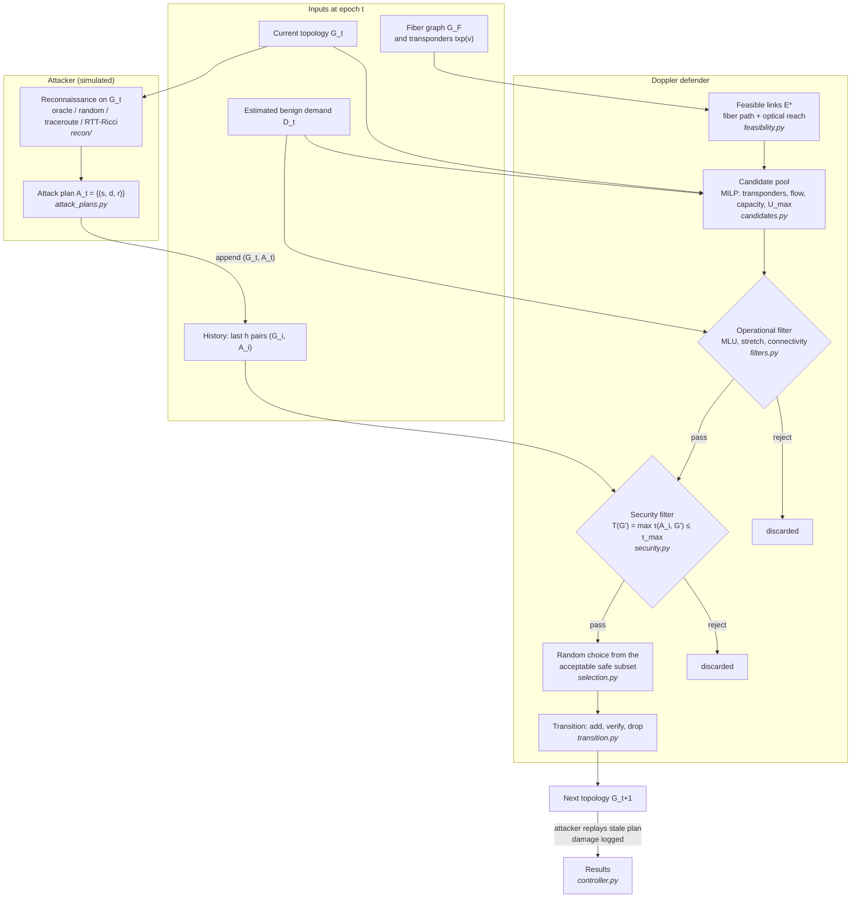

# Doppler control loop

What happens in one epoch. This is the design in paper §4.3 (Fig. 1, which is
still a placeholder in the draft), with the attacker's side added so the
experiment can measure stale-plan damage. Boxes are labelled with the module
that implements them (planned).

Points worth noticing:

- The defender plans with **benign** demand only. Attack traffic reaches the
  defender only through the attack plans in the history.
- The MILP does not know about security. It proposes operationally plausible
  candidates; the two filters decide (paper Eq. 31).
- Randomness enters at exactly one place, the final choice, and its seed is
  recorded with every run.
