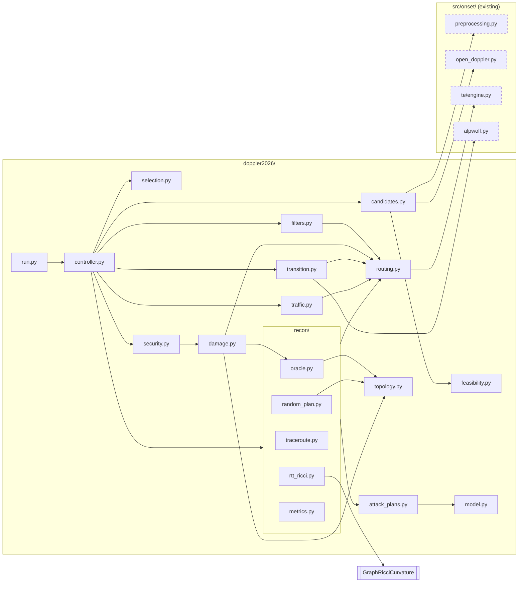

# Module map

How the planned modules in `doppler2026/` depend on each other and on
existing code in `src/onset/`. An arrow means "uses". Dashed boxes are
existing shared code.

`model.py` (shared dataclasses) is used by nearly every module; only the
`attack_plans.py` edge is drawn to keep the diagram readable.
