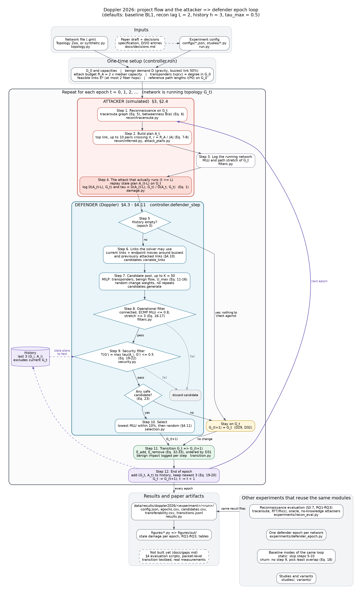

# Running Doppler by hand: the attacker => defender loop, epoch by epoch

This document lets you run one Doppler experiment with pencil and paper. It
describes **what the code does today with its default settings** (baseline
BL1, `decisions.md`), and says where that differs from the paper draft
*Doppler-security-26*.

- Code links point to commit `0943e98`. If line numbers drift, search for the
  function name given next to them.
- "§" and "Eq." refer to the paper; "p." is the PDF page.
- D/I/O/A/B numbers refer to `decisions.md` and
  `code_paper_discrepancies.md`.

Contents: [1. The idea](#1-the-idea-in-one-page) ·
[2. Setup](#2-setup-done-once) ·
[3. Four procedures](#3-four-procedures-you-will-reuse) ·
[4. The epoch](#4-one-epoch-step-by-step) ·
[5. Worked example](#5-worked-example-a-4-pop-ring) ·
[6. Limits of a hand run](#6-what-a-hand-run-cannot-reproduce) ·
[7. Paper vs code](#7-where-the-loop-differs-from-the-paper) ·
[8. How this was checked](#8-how-this-document-was-checked)

## 1. The idea in one page

An attacker learns the network, picks traffic pairs whose paths meet on one
link, and floods it. That takes time, so the attack that runs now was planned
on an older network. Doppler changes the network's IP links so old plans stop
working, without hurting normal traffic.



A plain-language version for explaining the process to others is in
[`diagrams/full_project_flow_simple.png`](diagrams/full_project_flow_simple.png).

Each epoch t has this timeline, with the network running topology G_t:

| When | Who | What | Does it affect Doppler's decision? |
|---|---|---|---|
| Steps 1-2 | Attacker | Measures G_t and builds plan A_t | Not this epoch. A_t enters the history at the end of the epoch |
| Step 3 | Logger | Records utilization and stretch of G_t | No |
| Step 4 | Attacker | Runs the old plan A_(t-2) against G_t | No. It is only measured |
| Steps 5-10 | Doppler | Chooses G_(t+1), testing candidates against A_(t-1), A_(t-2), A_(t-3) | This is the decision |
| Step 11 | Controller | Changes links from G_t to G_(t+1) | No. It is only measured |
| Step 12 | Controller | Adds (G_t, A_t) to the history and moves to t + 1 | Feeds the next epoch |

Three facts explain most of the behaviour:

1. **Doppler never sees the attack happening.** It only tests candidates
   against plans it assumes the attacker has.
2. **Why the current plan A_t is not tested.** The topology chosen now first
   runs at t + 1, when the attack uses A_(t-1) (lag L = 2). So A_(t-1) is what
   matters, and A_t is not needed yet (D30).
3. **The test covers a move, not a stay.** If Doppler stays put next epoch,
   a newer plan reaches a topology it was never tested against. The worked
   example shows this at epoch 5.

## 2. Setup (done once)

Code: [`controller.run`](../controller.py#L365), lines 367-385.

Write these on your first sheet. They never change during a run.

| Item | Symbol | Rule (default) | Where |
|---|---|---|---|
| PoPs and starting links | V, G_0 = (V, E_0) | From the network file | [`load_topology`](../topology.py#L29); §2.1 p.4 |
| Capacity | C_e | Per link, and **per direction**: A→B and B→A each get the full C_e | [`directed`](../routing.py#L26) |
| Link length | km | Great-circle distance between PoPs | [`great_circle_km`](../topology.py#L50) |
| Benign demand | D = {d_sd} | Gravity model, scaled so the busiest link is 50% full on G_0 under ECMP. **Same matrix every epoch** (D27, I5) | [`benign_demand`](../traffic.py#L63); §4.3 p.17 |
| Attack budget | R_A | 2 × median link capacity of G_0 (D21) | [`attack_config`](../security.py#L152) |
| Most attack pairs | N_A | 10 (D4) | [`SecurityConfig`](../security.py#L73) |
| Transponders | txp(v) | Degree of v in G_0, no spares (D18) | [`transponders`](../candidates.py#L184); §4.5 p.18 |
| Feasible links | E* | Links of G_0, plus PoP pairs exactly 2 hops apart in G_0 (D16) | [`feasible_links`](../feasibility.py#L67); §4.4 p.17 |
| New-link capacity | C_e | Median capacity of G_0 (D17) | [`link_capacities`](../candidates.py#L195) |
| Reference path length | l(P⁰_sd) | For each demand, the **longest** ECMP path on G_0, in km (D19) | [`reference_lengths`](../filters.py#L94) |

Other constants:

| Constant | Value | Meaning |
|---|---|---|
| L | 2 | Attack lag in epochs (D10) |
| h | 3 | Past states in the history (D3) |
| τ_max | 0.5 | Largest allowed stale effectiveness (D3) |
| K | 50 | Most candidates generated per epoch (D3) |
| T_opt | 60 s | Solver time per epoch (D25) |
| U_max | 0.8 | Largest allowed link utilization (D5) |
| S_max | 3 | Largest allowed path stretch (D5) |
| Selection tolerance | 10% | Width of the acceptable subset (D9) |

Start with: **G := G_0, plans list empty, history empty, t := 0.**

## 3. Four procedures you will reuse

### Procedure R: route a pair with ECMP

Code: [`_ecmp_routes`](../../src/onset/te/engine.py#L108). Paper: §2.1 p.4
leaves routing general; ECMP is the configured default.

1. Find all shortest paths from s to d, **counting hops**. Distance in km plays
   no part in routing.
2. Keep at most 3 of them (`path_budget`).
3. Give each kept path an **equal share**: 1 / (number of kept paths). The split
   is per path, not per hop.

Routes do not depend on traffic, so an attack does not move any traffic.

### Procedure P: build the attacker's plan on a topology G

Code: [`history_plan`](../security.py#L162) calls
[`simulate`](../recon/traceroute.py#L96),
[`observed_graph`](../recon/traceroute.py#L122),
[`betweenness`](../recon/inferred.py#L117),
[`plan_from_ranking`](../recon/inferred.py#L146) and
[`make_plan`](../attack_plans.py#L17).
Paper: §3.1.2 Eq. 5-6 p.10, §3.3 Eq. 7-8 p.11.

1. **Inferred graph Ĝ (Eq. 5).** Under the defaults, simply **use Ĝ = G**. The
   code does simulate probes with 10% silent routers, but every PoP is a
   vantage point, so each PoP probes its direct neighbours and sees every link
   (I7). The random seed therefore changes nothing.
2. **Score every link (Eq. 6).** For each unordered PoP pair {s, d}, list its
   shortest paths in Ĝ. Each path adds 1 / (number of shortest paths for that
   pair) to every link on it:

   ```text
   B(e) = sum over pairs of  σ_sd(e) / σ_sd
   ```

   The paper sums ordered pairs, which doubles every score. The ranking is the
   same.
3. **Pick the target link.** Take the highest B(e). Break ties by link name,
   smallest first. Write the link as {u, v} with u before v.
   *Caution:* the code compares floating-point sums, so scores that are exactly
   equal on paper can differ in the last digit when they involve fractions such
   as thirds. The code then does not follow the name order (section 6).
4. **Score each direction.** For direction u→v, go through all ordered pairs
   (s, d) and compute

   ```text
   share(s, d) = (shortest s→d paths that use u→v) / (all shortest s→d paths)
   ```

   Keep pairs with share > 0. Sort by largest share, then by pair name, and keep
   the first N_A = 10. The direction's score is

   ```text
   score = R_A / (pairs kept) × (sum of their shares)
   ```

   Repeat for v→u. The higher score wins. **On a tie, keep u→v.**
5. **Write the plan (Eq. 7-8).** A = the kept pairs, each sending

   ```text
   r = R_A / |A|
   ```

The attacker uses every shortest path here, while the network keeps at most 3.
With 3 or fewer tied paths the two agree.

### Procedure D: damage D(A, G)

Code: [`evaluate_damage`](../damage.py#L56), using
[`_capacity_constrained_delivery`](../../src/onset/te/engine.py#L904).
Paper: §2.4 p.6-7, §3.4 p.12. Damage measure: benign traffic lost (D1). Loss
sharing: proportional (D11).

1. Route every benign demand and every attack flow with Procedure R. Treat each
   (flow, path) as a separate piece with its share of the rate.
2. Give each directed link a **keep factor**, starting at 1.
3. Walk each piece along its path. The rate *arriving* at a link is the piece's
   rate multiplied by the keep factors of the links before it.
4. For each directed link:

   ```text
   arriving total <= C_e :  keep = 1
   arriving total >  C_e :  keep = C_e / arriving total
   ```

5. Repeat steps 3-4 until nothing changes. By hand, start with links nothing is
   upstream of, then work downstream; usually one or two passes are enough. If
   values bounce, move each keep factor halfway to its new value, which is what
   the code always does.
6. Benign delivered **with** the attack = sum over benign pieces of
   rate × (all keep factors on its path).
7. Repeat steps 2-6 with benign traffic only, for benign delivered **without**
   the attack. If no link overloads, this is simply all the benign demand.
8. The damage is

   ```text
   D(A, G) = (delivered without attack − delivered with attack) / total benign demand
   ```

**Shortcut.** A link's benign loss is (benign arriving) × (1 − keep). Sum this
over overloaded links, then divide by total benign demand. This works because
each lost unit is lost at one link.

### Procedure T: transferability τ

Code: [`relative_damage`](../damage.py#L134) and [`_ratio`](../damage.py#L229).
Paper: Eq. 1, §2.4 p.7.

```text
τ(A_i, G') = D(A_i, G') / D(A*, G')
```

A* is Procedure P run on G' itself: the same attacker measuring afresh (O3
option e). If D(A*, G') = 0 (D2):

| D(A_i, G') | τ | Meaning |
|---|---|---|
| 0 | 0 | Neither plan hurts: "attack-immune" |
| above 0 | ∞ | The old plan works where a fresh one does not, so the candidate fails |

τ can exceed 1, because the fresh plan is not an optimal attack.

## 4. One epoch, step by step

Code for the whole loop: [`controller.run`](../controller.py#L405). Step numbers
match the diagram.

### Attacker

**Step 1-2. Learn plan A_t on G_t.**
Run Procedure P on G_t and append A_t to your plans list. Set the pair
(G_t, A_t) **aside**; it does not join the history until step 12.
Code: [lines 411-413](../controller.py#L411). Paper: §3.1.2-§3.3 p.10-11.

**Step 3. Record the running network.** Compute the MLU and stretch of G_t using
Procedure O in step 8. This is for the log only, and G_t is not rejected if it
fails. Code: [lines 428-435](../controller.py#L428).

**Step 4. The attack that actually runs.** If t < 2, no attack runs yet. Otherwise:

1. Take the stale plan A_(t-2).
2. Compute D(A_(t-2), G_t) and D(A_t, G_t) with Procedure D.
3. Compute τ(A_(t-2), G_t), using A_t as the fresh plan.

Record these. **They are the experiment's security result and do not feed the
defender.** Code: [lines 437-459](../controller.py#L437). Paper: Eq. 1 p.7,
§4.14 p.24 (lag as a number of epochs is D10).

### Defender

**Step 5. Is there a history?** If the history is empty (epoch 0), skip to step
11 with G_(t+1) = G_t (D32). Code: [line 477](../controller.py#L477).

**Step 6. List the links the solver may use, set 𝓛.**
Code: [`variable_links`](../candidates.py#L231). Paper: §4.10 p.21, "local
candidate set" (D23).

1. Start with every link of G_t.
2. Rank G_t's links by edge betweenness (same scores as Procedure P, ties by
   name) and take the top ⌈10% of links⌉, at least 1.
3. Add the target link of each plan in the history, if that link exists in G_t.
4. For each link (u, v) from 2-3, "move one endpoint":
   - for each neighbour n of u other than v, propose link (n, v);
   - for each neighbour n of v other than u, propose link (u, n).
5. Add the proposals that are in E*.

**Step 7. Generate candidates.**
Code: [`generate`](../candidates.py#L383), model in
[`_Model`](../candidates.py#L255). Paper: §4.4-4.7 Eq. 11-16 p.18-19, §4.11
p.22.

A candidate G' is any set of links from 𝓛 with x_e = 1 meaning "active", where:

```text
Eq. 11      for each PoP v:   active links at v  <=  txp(v)
Eq. 12-14   all benign demand can be routed as a flow, split any way
Eq. 15-16   on each direction of each link:  flow <= U_max × C_e × x_e
extra       G' differs from G_t and from every earlier candidate (I14)
```

**By hand, on a small network:** list every subset of 𝓛 that meets Eq. 11, is
connected, and differs from G_t. You can skip Eq. 12-16 here. Any candidate that
would fail them also fails step 8, because an ECMP routing within U_max is itself
a valid flow. This gives the same final result as long as the pool is below K.

**On a larger network**, the solver finds candidates one at a time. Before each
solve it draws a fresh weight w_e, uniform on [1, 3], for each link in 𝓛, and
minimizes:

```text
sum over current links dropped of w_e  +  sum over new links added of w_e  +  MLU_solver
```

It stops at K = 50 candidates, at T_opt, or when none remain. This favours small
changes, and removals are the cheapest (D22, "What drives the sparsification" in
`decisions.md`). **T(G') is not in this objective** (A4).

**Step 8. Operational filter (Procedure O).**
Code: [`operational_check`](../filters.py#L112), called from
[`evaluate`](../controller.py#L186). Paper: §4.7 Eq. 16-17 p.19.

For each candidate, using benign traffic only and Procedure R:

1. **Connected?** If not, reject it.
2. **Utilization (Eq. 16).** Add up benign load on each directed link.

   ```text
   MLU = max over directed links of  load / C_e       require MLU <= 0.8
   ```

3. **Stretch (Eq. 17).** For each demand, take the longest ECMP path on G', in km.

   ```text
   stretch_sd = l(P'_sd) / l(P⁰_sd)                   require every stretch_sd <= 3
   ```

   The reference is always G_0, so stretch cannot creep up over epochs.

Keep the MLU; step 10 needs it.

**Step 9. Security filter.**
Code: [`security_check`](../security.py#L277). Paper: §4.8 Eq. 19-22 p.20.

For each candidate G' that passed step 8:

1. Build the fresh plan A* on G' (Procedure P) and compute D(A*, G').
2. For each plan A_i in the history (at most 3, Eq. 20), compute D(A_i, G') and
   τ(A_i, G').
3. Take the worst and test it:

   ```text
   T(G') = max over A_i of τ(A_i, G')       (Eq. 21)
   safe if T(G') <= 0.5                     (Eq. 22)
   ```

The candidates that pass form the safe set S_t (Eq. 23, §4.9 p.21).

**Step 10. Select the next topology.**
Code: [`select`](../selection.py#L50). Paper: §4.11 p.22 (D9, D24).

- **No safe candidate:** G_(t+1) = G_t (D29).
- **Otherwise:**
  1. Find the lowest MLU among safe candidates, m.
  2. The acceptable subset is every safe candidate with MLU <= 1.1 × m.
  3. Choose one uniformly at random. By hand, roll a die.

T(G') is **not** used to rank safe candidates; any value up to 0.5 counts equally.

### Transition and bookkeeping

**Step 11. Change the links.**
Code: [`order_changes`](../transition.py#L93),
[`evaluate_transition`](../transition.py#L177). Paper: §4.13 Eq. 32-33 p.23
(order is D31).

```text
E_add = E_(t+1) \ E_t          E_remove = E_t \ E_(t+1)
```

Free transponders at v = txp(v) − active links at v. Then:

1. **Add** every new link with a free transponder at both ends, in name order.
   Repeat while any fits.
2. If additions remain: for each blocked addition, in name order, at each endpoint
   with no free transponder, **remove** the first old link (by name, from E_remove)
   at that endpoint.
3. **Add** what now fits. Repeat 2-3 until all additions are made.
4. **Remove** the remaining old links.

If step 2 removed nothing, the transition is *make-before-break*. Otherwise it is
*break-before-make*. After each numbered step, record whether the network is
connected, its MLU, and the share of benign traffic not delivered, counting
unroutable demand as lost. **No attack traffic is included, and this result does
not influence which topology was chosen.**

**Step 12. End the epoch.** Code: [lines 540-541](../controller.py#L540).

1. Add (G_t, A_t) to the history and keep only the newest 3.
2. Set G := G_(t+1) and t := t + 1. Go to step 1.

### A worksheet for each epoch

```text
EPOCH t = ___        G_t links: ______________________

ATTACKER   B(e): ________________   target: ___→___
           A_t pairs: _______________   rate r = R_A/|A| = ____
ATTACK     (t >= 2) plan used: A_(t-2) = __________
           D(stale, G_t) = ____   D(A_t, G_t) = ____   τ = ____
DEFENDER   history: A_(t-1), A_(t-2), A_(t-3) = ___________
           𝓛 = __________________   candidates: ____

  candidate | connected | MLU | max stretch | OK? | D(A*) | D(A_i) ... | τ ... | T | safe?
  ----------|-----------|-----|-------------|-----|-------|------------|-------|---|------

SELECT     best MLU m = ____   limit 1.1m = ____   acceptable: ______   chosen: ______
MOVE       E_add = ____   E_remove = ____   actions: _______________
END        history := ____________   G_(t+1) = ____________
```

## 5. Worked example: a 4-PoP ring

This toy was chosen so everything fits on paper, and its demands are hand-set
round numbers instead of the gravity model. Every result below matches the real
controller run on the same input.

### Setup

Four PoPs on a ring, each link 100 in each direction: **G_0 = {AB, BC, CD, AD}**.

```text
A ---- B
|      |        Diagonals AC and BD do not exist yet, but are feasible.
D ---- C
```

| Link | AB | BC | CD | AD | AC | BD |
|---|---|---|---|---|---|---|
| km | 444.8 | 333.6 | 444.2 | 333.6 | 555.8 | 555.8 |

Benign demand, from row to column (total **150**):

| | A | B | C | D |
|---|---|---|---|---|
| **A** | | 5 | 10 | 5 |
| **B** | 30 | | 5 | 30 |
| **C** | 10 | 5 | | 10 |
| **D** | 10 | 20 | 10 | |

- R_A = 2 × 100 = **200**.
- txp = **2** at every PoP.
- E* = all 6 possible links, since A-C and B-D are 2 hops apart.
- The busiest link on G_0 is B→A at 50, so the MLU is 0.5, as the setup rule requires.

Reference lengths l(P⁰). Opposite corners have two paths, and the longer counts:

| Demand | AB, BA | BC, CB | CD, DC | AD, DA | AC, CA, BD, DB |
|---|---|---|---|---|---|
| km | 444.8 | 333.6 | 444.2 | 333.6 | 778.4 |

### Epoch 0: the attacker learns, Doppler waits

**Step 1.** Each adjacent pair uses its link (+1). Each opposite pair has two
2-hop paths, adding ½ to all four links, and there are two such pairs (+1). So
every link has B = 2. The tie goes to **AB**.

**Step 2.**

| Direction | Pairs crossing it (share) | Score |
|---|---|---|
| A→B | A→B (1), A→C (½), D→B (½) | 200/3 × 2 = 133.3 |
| B→A | B→A (1), B→D (½), C→A (½) | 200/3 × 2 = 133.3 |

Tied, so A→B stays. **A_0 = {A→B, A→C, D→B}, each at 66.67.**

**Steps 3-5.** The MLU is 0.5 and stretch is 1. There is no attack before epoch
2, and the history is empty, so Doppler stays.

**Step 12.** History = [(G_0, A_0)]. G_1 = G_0.

### Epoch 1: the first real decision

**Steps 1-4.** The network is unchanged, so A_1 = A_0. There is still no attack.

**Step 6.** The top ⌈0.4⌉ = 1 link is AB, also the history's target. Around AB:
A's other neighbour D gives DB, and B's other neighbour C gives AC. So
𝓛 = {AB, BC, CD, AD, **AC, BD**}.

**Step 7.** With txp = 2, a connected candidate must be a ring or a path through
all 4 PoPs. There are 3 rings and 12 paths, minus G_1 itself: **14 candidates**.

**Step 8.** Eight pass:

| Candidate | MLU | Max stretch | Result |
|---|---|---|---|
| AB AC BD CD | 0.375 | 2.9995 | pass |
| AB BD CD | 0.50 | 2.9995 | pass |
| AB AC CD | 0.65 | 2.9995 | pass |
| AD BC CD | 0.80 | 2.499 | pass |
| AD BC BD | 0.80 | 2.002 | pass |
| AB AD BC | 0.80 | 2.503 | pass |
| AC AD BC | 0.80 | 2.002 | pass |
| AC AD BC BD | 0.50 | 2.002 | pass |
| AB AC BD | 0.55 | 3.504 | **fail** (stretch) |
| AB AD CD | 0.65 | 3.665 | **fail** (stretch) |
| AB BC CD | 0.50 | 3.665 | **fail** (stretch) |
| AC AD BD | 0.65 | 4.332 | **fail** (stretch) |
| AC BC BD | 0.55 | 4.332 | **fail** (stretch) |
| AC BD CD | 0.65 | 3.498 | **fail** (stretch) |

Example for the first row: demand A→D goes A-B-D or A-C-D. The longer is
444.8 + 555.8 = 1000.6 km, and 1000.6 / 333.6 = 2.9995, just under 3.

**Step 9, worked for G' = {AB, AC, BD, CD}.**

*Benign load.* On this new ring, AB, AC, BD, CD are direct. The demands A→D,
B→C, C→B, D→A each split over two 2-hop paths. Result:

| Directed link | A→B | A→C | B→A | B→D | C→A | C→D | D→B | D→C |
|---|---|---|---|---|---|---|---|---|
| Benign | 10 | 15 | 37.5 | 35 | 17.5 | 15 | 27.5 | 17.5 |

The maximum is 37.5, which gives the MLU of 0.375.

*Old plan A_0 on G'.* All three pairs are now direct links:

| Link | Benign + attack | Total |
|---|---|---|
| A→B | 10 + 66.67 | 76.67 |
| A→C | 15 + 66.67 | 81.67 |
| D→B | 27.5 + 66.67 | 94.17 |

Nothing exceeds 100, so **D(A_0, G') = 0**.

*Fresh plan A\* on G'.* All links tie at B = 2, so the target is AB again. A→B is
crossed by A→B (1), A→D (½) and C→B (½), and the direction tie keeps A→B.
A\* = {A→B, A→D, C→B} at 66.67 each.

The attack on A→B is 66.67 + 33.33 + 33.33 = 133.33. With 10 benign, the offered
total is 143.33, so keep = 100 / 143.33 = 0.6977.
Benign lost = 10 × (1 − 0.6977) = 3.023, so **D(A\*, G') = 3.023 / 150 = 0.0202**.

*Result.* τ = 0 / 0.0202 = 0, so **T(G') = 0: safe**.

All eight, with the same procedure:

| Candidate | D(A_0, G') | D(A*, G') | T(G') | Safe? |
|---|---|---|---|---|
| AB AC BD CD | 0 | 0.0202 | **0** | yes |
| AB BD CD | 0.0777 | 0.2017 | **0.385** | yes |
| AD BC CD | 0.1745 | 0.3733 | **0.467** | yes |
| AB AC CD | 0.1433 | 0.2895 | **0.495** | yes |
| AD BC BD | 0.1745 | 0.3421 | 0.510 | no |
| AB AD BC | 0.1839 | 0.2022 | 0.909 | no |
| AC AD BC | 0.1839 | 0.2022 | 0.909 | no |
| AC AD BC BD | 0.0569 | 0.0393 | 1.448 | no |

**Step 10.** Safe MLUs are 0.375, 0.5, 0.8, 0.65. Best m = 0.375, limit 0.4125.
Only **{AB, AC, BD, CD}** qualifies, so no die is needed.

**Step 11.** E_add = {AC, BD}, E_remove = {AD, BC}. Every transponder is busy, so:

| Step | Action | Links now | Connected | Benign lost |
|---|---|---|---|---|
| 2 | remove AD, BC | AB, CD | **no** | **63.3%** |
| 3 | add AC, BD | AB, AC, BD, CD | yes | 0 |

Only AB, BA, CD, DC can be delivered mid-change: 5 + 30 + 10 + 10 = 55 of 150.
The chosen move is break-before-make, and that 63.3% loss played no part in
choosing it.

**Step 12.** History = [(G_0, A_0), (G_1, A_1)]. Both entries are the same here.

### Epoch 2: the first attack, and a chained overload

**Steps 1-2.** G_2 = {AB, AC, BD, CD}, so A_2 = {A→B, A→D, C→B} at 66.67.

**Step 4.** The attack uses A_0: **D = 0, fresh D = 0.0202, τ = 0.** The old plan
has fully expired.

**Steps 6-9.** 𝓛 is again all 6 links, with 14 candidates. The original ring is
now a candidate, and it fails with T = 1.0: the history blocks a return to a
topology the attacker already knows (§4.2 G4). Three candidates are safe.

**Worked τ for G' = {AB, BD, CD}, a path A-B-D-C.** Every pair has one route.

*Old plan A_0* = A→B, A→C, D→B at 66.67. Work downstream:

| Link | Arriving | Keep |
|---|---|---|
| A→B | benign 20 + attack 133.33 = 153.33 | 100/153.33 = **0.6522** |
| D→B | benign 45 + attack 66.67 = 111.67 | 100/111.67 = **0.8955** |
| B→D | (10 + 5 + 66.67) × 0.6522 + 35 = 88.26 | 1 |

The offered load on B→D was 116.67, but upstream loss at A→B brings it under
capacity. Benign lost = 20 × 0.3478 + 45 × 0.1045 = 6.957 + 4.702 = 11.659.
**D(A_0, G') = 11.659 / 150 = 0.0777.**

*Fresh plan.* B(AB) = 3, B(BD) = 4, B(CD) = 3, so the target is BD. Pairs A→C,
A→D, B→C, B→D each have share 1, so r = 200 / 4 = 50.

| Link | Arriving | Keep |
|---|---|---|
| A→B | 20 + 100 = 120 | 100/120 = **0.8333** |
| B→D | (15 + 100) × 0.8333 + 35 + 100 = 230.83 | 100/230.83 = **0.4332** |

Benign lost at A→B = 20 × 0.1667 = 3.333. Benign reaching B→D is
15 × 0.8333 + 35 = 47.5, of which 47.5 × 0.5668 = 26.92 is lost.
**D(A\*, G') = 30.26 / 150 = 0.2017.**

*Result.* τ = 0.0777 / 0.2017 = **0.385**. Both history entries hold the same plan,
so T = 0.385: safe.

**Step 10.** Safe MLUs: 0.5, 0.8, 0.65. The limit is 0.55, so **{AB, BD, CD}** is
chosen. Removing AC alone is make-before-break, with no loss.

### Epochs 3 to 7

From here the same steps repeat. "Attack" is the stale plan running that epoch.

| t | G_t | Fresh plan A_t (target; rate) | Attack plan | D(stale, G_t) | D(A_t, G_t) | τ | 𝓛 size / pool / pass ops / safe | Decision |
|---|---|---|---|---|---|---|---|---|
| 0 | AB AD BC CD | A→B; 66.67 | none | | 0.0464 | | no history | stay |
| 1 | AB AD BC CD | A→B; 66.67 | none | | 0.0464 | | 6 / 14 / 8 / 4 | → AB AC BD CD |
| 2 | AB AC BD CD | A→B; 66.67 | A_0 | **0** | 0.0202 | **0** | 6 / 14 / 8 / 3 | → AB BD CD |
| 3 | AB BD CD | B→D; 50 | A_1 | **0.0777** | 0.2017 | **0.385** | 5 / 6 / 4 / 1 | → AD BC CD |
| 4 | AD BC CD | C→D; 50 | A_2 | **0.0987** | 0.3733 | **0.264** | 5 / 6 / 3 / 0 | stay (no safe) |
| 5 | AD BC CD | C→D; 50 | A_3 | **0.1929** | 0.3733 | **0.517** | 5 / 6 / 3 / 0 | stay (no safe) |
| 6 | AD BC CD | C→D; 50 | A_4 | **0.3733** | 0.3733 | **1.0** | 5 / 6 / 3 / 0 | stay (no safe) |
| 7 | AD BC CD | C→D; 50 | A_5 | **0.3733** | 0.3733 | **1.0** | 5 / 6 / 3 / 0 | stay (no safe) |

Epoch 3's decision, with history plans A_0, A_1, A_2:

| Candidate | τ(A_0), τ(A_1), τ(A_2) | T(G') | Safe? |
|---|---|---|---|
| AD BC CD | 0.467, 0.467, 0.264 | 0.467 | yes |
| AD BC BD | 0.510, 0.510, 0.136 | 0.510 | no |
| AB AD BC | 0.909, 0.909, 0.310 | 0.909 | no |
| AB AD BC CD | 1.0, 1.0, 0 | 1.0 | no |

Its move is break-before-make: remove BD, add AD and BC, then remove AB. The
network is again disconnected in the middle, with 63.3% of benign traffic lost.

### What the example teaches

- **The filter's number comes true after a move.** τ(A_1, G_3) was 0.385 in the
  epoch 2 test and 0.385 when the attack ran in epoch 3. The same holds for
  τ(A_2, G_4) = 0.264.
- **After a stay it is not protected.** At epoch 5, plan A_3 hits G_5 with
  τ = 0.517, above τ_max. A_3 was never tested against this topology, because
  G_4 was chosen before A_3 entered the history and no move happened at epoch 4.
- **The attacker catches up when Doppler runs out of moves.** From epoch 6 the
  stale plan was learned on the same topology, so τ = 1.
- **Low τ does not mean low damage** (O7, A6). A static ring loses 0.0464 per
  attacked epoch. Doppler's τ stays below 0.5 through epoch 4, yet its absolute
  losses reach 0.0987 by then and 0.3733 by epoch 6, as the network thins from 4
  links to 3 and its MLU rises from 0.5 to 0.8.

## 6. What a hand run cannot reproduce

| Situation | Why | What to do |
|---|---|---|
| Pool reaches K = 50 | Which candidates appear depends on the solver's random weights | Keep the toy small enough that the pool is below 50 |
| Several acceptable candidates | The code uses a seeded NumPy generator | Roll a die. Your path may differ from the code's, but it is still valid |
| More than 3 tied shortest paths | The code keeps the first 3 in NetworkX's order | Cannot happen with 5 or fewer PoPs. On larger toys, avoid them |
| Solver hits T_opt | Depends on machine speed | Does not arise in a small toy |
| Link scores tied exactly, with thirds or similar fractions | The code compares rounded floating-point sums. For example, links all scoring 7/3 were stored as 2.3333333333333335 or 2.333333333333333, so AE ranked ahead of AC | Your tie-break by name is the documented rule, but the code may pick another tied link. Toys whose scores are whole numbers or halves, like the one above, are not affected |

## 7. Where the loop differs from the paper

Only items that change what you do in the loop are listed.
`code_paper_discrepancies.md` has the full record.

| Step | Paper | Code | Record |
|---|---|---|---|
| 1 | Real traceroute measurements | Simulated, on networks with no real measurements | B1 |
| 4 | Attack timing described in general terms (§4.14) | Lag fixed at L epochs, default 2; epochs are abstract, not timed | D10, B8 |
| 5 | History G_(t-1) ... G_(t-h), with no lag stated | Same history, valid under the added assumption L >= 2; Doppler stays at epoch 0 | D30, D32, A2 |
| 6-7 | E* from fiber, ROADMs, spectrum, reach | Original links as fibers, 2-hop rule, no ROADM or spectrum data | B3, B4 |
| 7 | Minimize T(G') (Eq. 25) | Minimize weighted changes plus MLU; T(G') tested afterwards | A4 |
| 7 | K counts configurations that satisfy all filters (Eq. 31) | K counts generated candidates; `pool_counts = "accepted"` gives the paper's reading | A3, D33 |
| 7 | Transponders are an input | Assumed equal to original degree; new links get median capacity | B5, B6 |
| 11 | Convergence and packet loss measured | Flow-level states only, ordered but not timed | B7 |

The paper does not fix these choices, so the code's values are project decisions:
the damage measure (D1), proportional loss (D11), τ with a zero denominator (D2),
the fresh plan A* (O3 option e), τ_max, h, K, U_max, S_max (D3, D5), what happens
with no safe topology (D29), and the transition order (D31).

## 8. How this document was checked

The instructions were turned into a separate small program that uses none of the
Doppler modules, and its results were compared with the real
`controller.run` at default settings. The program was a one-off check and is not
part of the repository.

| Check | Result |
|---|---|
| The ring in section 5, 8 epochs | Plans, damage, τ, candidates, filter results, T(G'), selections and transitions all match |
| 80 random networks of 4-5 PoPs, 4 epochs each | 9 skipped because the pool reached K = 50 (section 6). Of the other 71 (284 epochs, 5,203 candidates), 69 match outright |
| The 2 networks that differed | Both are explained by the floating-point ties in section 6. Both match once the program uses the code's own rounded link ranking |
| Ĝ = G and the plan does not depend on the seed | Held on sprint, ANS, CRL, bellCanada and surfNet at their starting topologies: Ĝ = G for seeds 1-5, and those plans equal the seed 0 plan |
| Target link on those five starting topologies | The same with exact arithmetic and with the code's rounding |

Not checked by this comparison: which candidates the solver finds when the pool is
capped at K, and behaviour when the solver reaches T_opt. Neither can be reproduced
by hand. The paper links are by section and PDF page of the draft in this folder.
